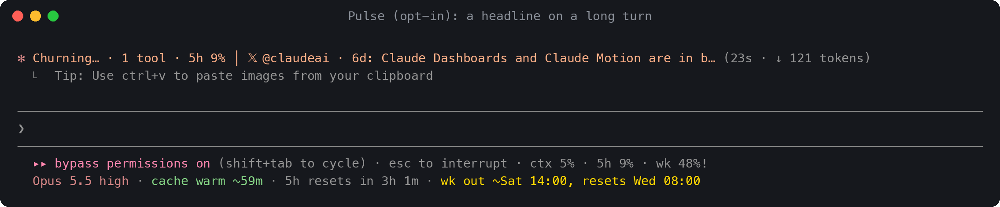

# g-line

**Live status. Receipts on the turns.**

g-line is a Claude Code mod that puts context jumps, cache rebuilds and tool failures on the
turns where they happen, not just in a status bar. Model and effort, the prompt cache and your
usage windows stay under the prompt.

In Claude Code 2.1.293 or later, type at the prompt:

```text
/plugin install g-line --marketplace lifeofgurpreet/g-line
```


## What it does

- **The unusual turn identifies itself.** The line that closes each turn (`Worked for 20s ·
  done 11:01 AM`) gets a receipt. An ordinary turn says what it cost at API prices and how
  much of its input the prompt cache served: `API $0.22 · cache read 49%`. An unusual one
  leads with up to two of these, in colour: `+86k context`, `cache cold · rebuilt 42k`,
  `cache write 84k`, `3 failed Bash calls` or `compacted 182k → 31k`. A cost several times
  your recent turns says so: `API $1.42 · 4x recent`. Scroll back to see which turn changed
  things.
- **The warning stays with the work.** While a turn runs, the spinner shows its burn
  (`3 tools · +4.1k ctx · 5h 74%`). When calls keep failing, it names the tool and the file:
  `⚠ 3× Edit failures on core.ts`. The receipt keeps that record after the turn ends.
- **What matters stays visible.** Your gauges ride at the end of Claude Code's own hint line
  (`ctx 13% · 5h 1% · wk 79%!`). One coloured line under it has the model and its effort, the
  cache countdown and what happens next: `Opus 5.5 high · cache ~59m · wk out ~Thu 19:00,
  resets Fri 16:00`. Nothing goes above the prompt.
- **A heads-up before the cache goes cold.** A native notification five minutes before a
  one-hour prompt cache expires, with what's at stake: `Claude cache goes cold in 5m (148k of
  context at risk)`. Another tells you when a usage window resets after you came close to
  its limit.


Answer `y` to add the marketplace and pick a scope (user is the usual choice). The mod starts
at once, with no restart. To remove it, run `/plugin uninstall g-line`.

## Why a mod

A `statusLine` command is a separate program. Claude Code runs it and prints what it prints
in a status area under the prompt. A mod runs inside Claude Code and can draw on Claude
Code's own lines. That is what makes g-line possible:

- the receipt on each turn's own closing line, kept beside that turn in the terminal;
- the burn and failures on the working spinner, while the turn runs;
- the gauges at the end of the existing hint line, so the footer grows by one row, not two
  or three;
- each request's cache reads and writes, every tool call and its result, subagents, and
  compactions, read from the engine as they happen rather than from the transcript file;
- a `/g-line` command that runs without a Claude turn, a pane with buttons, and native
  notifications through your own notification channel.

## How it compares

Read from each project's README on 2026-10-14. "Not documented" means not in its docs, not
impossible.

| | g-line | claude-hud | ccstatusline | claude-powerline | ccusage |
| --- | --- | --- | --- | --- | --- |
| What it is | Claude Code mod | Plugin that sets up a `statusLine` command | `statusLine` command | `statusLine` command | Usage-report CLI with a statusline command |
| Where it draws | The hint line, one row under it, the spinner, each turn's closing line | Its status lines (two by default) | Its status lines, configurable | Its status lines, powerline style | Its status line, and separate reports |
| Receipt on each turn's own line | Yes | Not documented | Not documented | Not documented | Not documented |
| Model and effort | Yes | Yes (effort optional) | Yes (widget) | Yes | When Claude Code supplies it |
| Prompt-cache countdown | Yes, an estimate | Optional | Yes (widget) | Optional | Not documented |
| Limits with pace | Projected run-out time | Usage windows, pace colours | Usage and reset widgets | Usage with an even-spend pace marker | Block cost, time and burn rate |
| History | Receipts in scrollback; today and this week in the pane | Optional cost ledger | Session and compaction widgets | Today and month budgets | Daily, monthly and session reports |
| Where activity comes from | Engine events | Status data; optional lines read the transcript | Status data, transcript and usage API, by widget | Status data and local transcripts, by feature | Local usage records |
| Pick it to | See which turn changed things, beside the work | Get a configurable session overview | Get extensive widget customisation | Get a styled layout with budgets | Get retrospective usage analysis |

Already happy with one of those? Set `lines` to `receipts`: g-line then adds only the
receipts, spinner and heads-ups, and leaves your status line alone.

## What you see

### The receipt

| Receipt | When |
| --- | --- |
| `API $0.22 · cache read 49%` | An ordinary turn: its cost at API prices and the share of its input the cache served |
| `+86k context` | The turn grew the context by at least 8k tokens, or by 2% of the window when that is more |
| `cache cold · rebuilt 42k` | The turn's first request came after the cache's lifetime and rewrote it |
| `cache write 84k` | A request wrote at least 20k tokens to the cache, well beyond what the context grew |
| `3 failed Bash calls` | Two or more tool calls failed in the turn (named when they were all one tool) |
| `compacted 182k → 31k` | The context was compacted during the turn |
| `API $1.42 · 4x recent` | At least three times the median of your recent turns, and at least 20 cents more |

These are observations, not diagnoses. g-line says a cold cache was rebuilt; it doesn't say
whose fault that was. When a background agent ran alongside the turn, the session's cost
growth isn't the turn's alone, so the dollar figure is left out. A narrow terminal drops the
supporting facts first.

### The two lines under the prompt

Line 1, at the end of Claude Code's hint line, drawn dim by Claude Code:

| Segment | Example | What it means |
| --- | --- | --- |
| context | `ctx 13%` | How full the context window is, from the last response |
| 5h, week | `5h 1%`, `wk 79%!` | Your usage windows. `!` means on pace to run out before the reset |
| spend | `spend 83%` | Behind a Claude gateway that sets a spend limit |

Line 2, g-line's own row, in colour:

| Segment | Example | What it means |
| --- | --- | --- |
| model | `Opus 5.5 high` | The model and the effort of the last request (`fast` when fast mode is on) |
| cache | `cache ~59m`, `cache cold` | How long the prompt cache stays warm, green, then amber in its last minutes. `~` because it's an estimate from when the last request ran and the cache's lifetime |
| timing | `wk out ~Thu 19:00, resets Fri 16:00` | When a window on pace to run out gets there (rounded: it's a projection), else when it resets |
| agents, compaction | `agents 2 running`, `compacts in ~3 turns` | While subagents work; when a compaction is near |

When the terminal narrows, line 2 shortens first (`Opus 5.5` to `Opus`, the effort kept), and
what line 1 can't fit moves down rather than vanishing. A healthy window's reset time goes
first; the warning keeps its projection the longest.


Prefer one line? Set `lines` to `1`: everything rides on the hint line, and Claude Code's
standing hint `(shift+tab to cycle)` shortens to `⇧⇥` to make room. Claude Code's own
permission-mode label (`⏵⏵ bypass permissions on`) is drawn beside the hint where no mod can
change it, so g-line leaves it as it is.

### The spinner

`Sautéing… · 3 tools · +4.1k ctx · 5h 74%` while a turn runs, and
`⚠ 3× Edit failures on core.ts` first once calls keep failing.


### Pulse (off unless you turn it on)

`/g-line pulse` turns on **Pulse**: on a turn that runs longer than 15 seconds, the spinner
shows one AI-dev headline at a time after its burn (`│ Claude Code 2.1.296 released (Claude
Code releases)`), and the `/g-line` pane lists the day's top five, with links. Headlines come
from g-line's own static feed: Claude Code releases, posts on 𝕏 from @claudeai, @AnthropicAI
and the Claude Code team, Anthropic's news pages, Hacker News stories about Claude, Simon
Willison's AI posts, and a few items the maintainer picks. Each is labelled with where it came
from. A post on 𝕏 leads with its author, and with its age once it is a day old
(`│ 𝕏 @claudeai · 2d: Claude Dashboards and Claude Motion are in beta today…`). The feed
finds those posts without an X API key, so it can run a few days behind X itself.

When Pulse is on, g-line fetches one file,
`raw.githubusercontent.com/lifeofgurpreet/g-line/pulse/pulse.json`, at most every 45 minutes.
It sends nothing about you, it never fetches while drawing, and it gives up after five
seconds. Headline text is stripped of escape and control characters before it reaches your
terminal. With Pulse off (the default), g-line makes no network requests at all.



### The pane, settings and share card

`/g-line` opens a pane with every figure spelled out: limits with bars and reset times,
warnings, agents, the last turns' receipts, what fills the context (counted locally, like
`/context`), tools used and failed, and today's and this week's totals across sessions. Its
top row changes settings without editing JSON: **Layout** (two lines, one line, receipts
only), **Notifications**, **Pulse** and **Receipt** (adaptive, fixed, off). Choices stick
across sessions. `/g-line card` shows a share card of the session with a copy button; it
leaves out your repository, branch, paths and account. `/g-line off` hides everything g-line
draws and keeps it quiet until `/g-line on`.


## Configure

`/config` lists six settings: **Layout** (`2`, `1` or `receipts`), **One-line preset**,
**Icons**, **Heads-up toasts**, **Native notifications** and **Turn receipt**. The pane's top
row sets the common ones. For the rest, add `~/.config/g-line/config.json` (or put it under
`$XDG_CONFIG_HOME`):

```json
{
  "lines": 2,
  "git": true,
  "notify": { "cache": true, "reset": true, "long_turn": true },
  "today_budget": 50
}
```

| Key | Values | Default |
| --- | --- | --- |
| `lines` | `2`, `1`, or `receipts` (receipts, spinner and heads-ups only) | `2` |
| `receipt` | `adaptive`, `short` (cost, cache, tools), `full`, `off`, or a list of `cost`, `cache`, `context`, `tools`, `agents`, `output` | `adaptive` |
| `pulse` | `true` fetches the headline feed (see Pulse) | `false` |
| `git` | `true` puts your branch on line 2; g-line then runs `git status` in your project | `false` |
| `notify` | `true`, `false`, or per kind: `cache`, `reset`, `long_turn` (a turn longer than `long_turn_seconds` finished), `agents` (a background agent finished) | `cache` and `reset` on |
| `toasts` | `true`, `false` | `true` |
| `spinner` | `true`, `false`: the burn on the spinner | `true` |
| `tool_streak` | Failures in a row of the same call before the toast; `0` turns it off | `3` |
| `today_budget` | Dollars at API prices; today's total across sessions joins line 2 and a toast says when you pass it | none |
| `coach` | `true` offers `/effort` or `/model` for Tab to take when the 5-hour window is on pace to run out, and `/compact keep ` before a compaction. It never changes anything itself | `false` |
| `claude_reads` | `true` gives Claude a `status` tool to read these figures when you ask it to (see below) | `false` |
| `reset_threshold`, `long_turn_seconds`, `cache_ttl`, `icons`, `segments`, `preset`, `short_hints`, `export_state`, `account_command` | See `hooks/register.tsx`. `account_command` runs a command you choose and shows its first line; off unless set | |

`~/.config/glanceline/config.json` from 0.4 is still read, and `g-line/config.json` wins.

### Let Claude read the figures (opt-in, experimental)

With `claude_reads: true`, g-line registers a tool, `status`, that returns a small JSON
snapshot: context used and the room before auto-compact (when Claude Code reports it), the
usage windows with projected run-out times, and the cache's estimated expiry, each with its
scope. Unknown figures are `null`, and it gives no advice. Its description tells Claude to use
it when you ask, and not to change model, effort or compaction on its own. Two honest notes:
the result enters the conversation like any tool result, so it goes to your model provider
with the rest of the conversation; and the tool is deferred only where tool search is
available.

## Privacy and what it runs

- **Reads:** the figures Claude Code hands every mod (usage, turns, tool calls and their
  results' success, subagents, compactions). It doesn't read the transcript file.
- **Keeps:** per session per day, numbers only (cost at API prices, turns, tool calls, cold
  rebuilds, agents) in Claude Code's plugin store, deleted after 35 days; your pane choices;
  and, with Pulse on, the last feed.
- **Runs:** `git status` only with `git: true` or while the pane is open; your
  `account_command` only if you set one.
- **Sends:** nothing, unless Pulse is on (one GET of a static file) or you enable
  `claude_reads` (the snapshot goes into your conversation).
- **Writes:** a one-line timestamp at `~/.cache/glanceline/live/<session id>` so an older
  status line command can step aside, and with `export_state`, a JSON file for other bars.

## Upgrading from glanceline 0.3 or 0.4

glanceline is now g-line. The repository moved to `lifeofgurpreet/g-line` (the old address
redirects), and the plugin has a new name, so Claude Code treats it as a new plugin. An
installed glanceline updates to a small stub that keeps loading and tells you, once per
session, to switch:

```text
/plugin uninstall glanceline
/plugin install g-line --marketplace lifeofgurpreet/g-line
```

Your `~/.config/glanceline/config.json` keeps working. `/glanceline` still opens the pane until
the next release. The day and week totals start again under the new name. If you used the old
Python status line (`glanceline install`), run `glanceline uninstall` once to put your previous
`statusLine` back. g-line no longer ships that fallback.

## Develop

See [AGENTS.md](AGENTS.md): the rules g-line stands on, a map of the code, and recipes for
adding a figure or a receipt event.

```sh
claude --plugin-dir .        # a session with your working copy; saving reloads it
claude plugin validate .     # what the engine reads, the hooks and calls, what it would refuse
claude plugin test .         # the tests
```

The screenshots and the demo are real captures (`tmux capture-pane -e`), drawn by
`scripts/ansi2png.py` and cut by `scripts/frames.py`. `tools/pulse/` builds the Pulse feed on
the maintainer's machine; it isn't part of the mod.

## License

MIT
