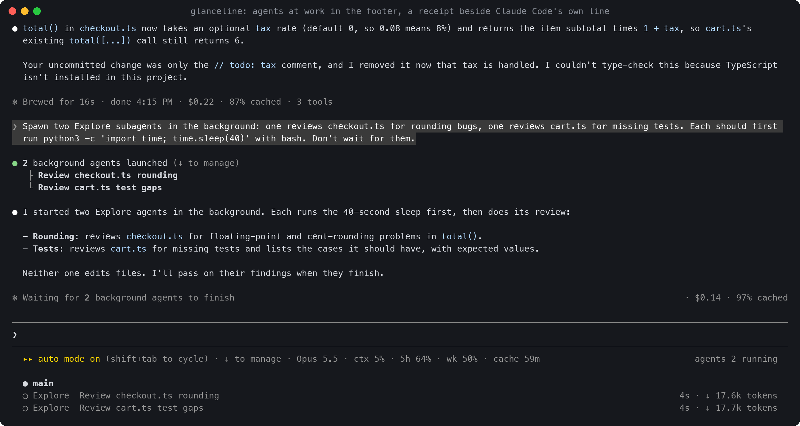
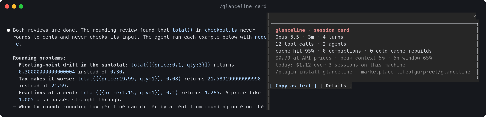

# glanceline

**Your Claude Code session at a glance, without a single extra row on screen.**

glanceline is a native Claude Code **mod**. It doesn't add a status bar: it writes onto the
lines Claude Code already draws. Your limits, context and prompt-cache countdown ride at the
end of the hint line under the prompt. Every turn's closing line becomes a receipt
(`Baked for 1m 4s · $0.38 · 94% cached · 7 tools`). Agents at work and an upcoming
compaction show in the footer's mode labels. And it tells you before you hit a wall, even
when you're in another app.


## What only a mod can do

Status line scripts print one line when Claude Code asks. A mod runs inside Claude Code,
sees each turn, tool call, subagent and compaction as it happens, and can draw onto Claude
Code's own lines. glanceline uses that for:

- **A receipt for every turn.** The `Baked for 1m 4s` line that ends each turn also says
  what the turn cost at API prices, how much of it the prompt cache served, and how many
  tools it ran. Scroll back and you can see which prompt burned your limit.
- **Zero extra rows.** The live figures sit on the hint line under the prompt, the agents
  and compaction forecast in the footer's mode labels, the running turn's progress on the
  spinner (`Thundering… · 2 tools`). Nothing goes above the prompt.
- **Heads-ups that reach you away from the terminal.** A native notification five minutes
  before a one-hour prompt cache goes cold, and when your 5-hour or weekly window resets
  after you'd come close to its limit. Toasts when a limit is on pace to run out, a
  background agent fails, the same tool call fails three times in a row, or the context is
  about to compact.
- **Subagents and background work.** `agents 2 running` in the footer while any are at
  work, straight from Claude Code's own agent list, and each agent's type, model, status
  and age in the pane.
- **A compaction forecast and log.** Once the context passes 60% of the auto-compact
  threshold, the footer says `compacts in ~3 turns`. Two turns out, a toast suggests
  `/compact` with a note while you still choose what's kept, and Tab starts it. Each
  compaction is logged with its before and after size.
- **What fills your context.** The pane breaks the window down the way `/context` does,
  counted locally with no API call, and names MCP servers whose tool definitions take room
  but which you never called this session.
- **Today and this week across sessions.** Each session adds its turns, tools and cost to a
  small store on your machine, so the pane shows today's total over every session and a
  seven-day sparkline.
- **A share card.** `/glanceline card` sums up the session (turns, tool calls, agents, cache
  hit rate, compactions, cost at API prices) with a button that copies it as text. It
  leaves out your repository, branch, paths and account.
- **A pace coach that only suggests.** When your 5-hour window is on pace to run out, the
  toast says how much slower you'd need to go to last until the reset and puts
  `/effort medium` (or `/model`) in the prompt box for Tab to take, once per window across
  all your sessions. It never changes your model or effort itself.
- **It keeps ticking while you're idle.** The cache countdown and window resets update on a
  timer, so the line is right when you come back to it.

Everything comes from figures Claude Code hands every mod. glanceline doesn't read your
transcript, estimate tokens Claude Code already reports, make network calls, or write
anything into the system prompt.

## Install

In Claude Code 2.1.293 or later, type at the prompt:

```text
/plugin install glanceline --marketplace lifeofgurpreet/glanceline
```

Answer `y` to add the marketplace and pick a scope (user is the usual choice). The line
appears right away, with no restart. To remove it, run `/plugin uninstall glanceline`.

Older Claude Code? Use the [status line fallback](#works-everywhere-the-status-line-fallback).

## What you see

### The hint line under the prompt

| Segment | Example | What it means |
| --- | --- | --- |
| model | `Opus 5.5 high` | The model, its reasoning effort, and `fast` when fast mode is on |
| context | `context 41% (118k left)` | How full the context window is, from the last response |
| 5h | `5h 23% (resets in 2h 14m, on track)` | Your 5-hour usage window |
| 5h, running hot | `5h 72%, out at 10:03` | At your average rate since the window opened, you hit 100% at 10:03, before the reset |
| week | `wk 41% (3d5h)` | Your weekly window, with the same pace check |
| spend | `spend $416 of $500 monthly` | Shown behind a Claude gateway that sets a spend limit |
| cache | `cache 59m` / `cache cold` | How long the prompt cache stays warm. When it's cold, the next turn rebuilds it |
| git | `feat/checkout*` | Your branch. `*` means tracked files have changes |

The line narrows as the terminal does: every segment has a wide, a medium and a short form,
and the least important segments drop first. The model, context and 5-hour window stay
until the very end.


### The footer, the spinner and each turn's closing line



- **Footer mode labels** (right of the hint line): `agents 2 running` while subagents or
  teammates are at work, `compacts in ~3 turns` once a compaction is near. Each label is
  there only while it has something to say.
- **Spinner**: what the running turn has done so far, `· $0.12 · 3 tools · 1 agent`.
- **Turn receipt**: `· $0.38 · 94% cached · 7 tools` after Claude Code's own words. When
  background work is still running, Claude Code may add `· 1 shell still running` there,
  so the receipt moves to the row's right end.


### The details pane and the share card

`/glanceline` opens a pane with every figure spelled out: bars, reset times, any warning
that's live, the agents, the last turns' receipts, what fills the context, the tools used
and failed, and today's and this week's totals. `/glanceline card` shows the share card.
`/glanceline off` hides everything glanceline draws on Claude Code's lines, and
`/glanceline on` brings it back.




## Configure

`/config` lists five settings: **layout** (`default`, `minimal` or `full`), **icons**
(`none` or `nerd`, for Nerd Font glyphs), **heads-up toasts** (on or off), **native
notifications** (on or off) and **turn receipt** (`short`, `full` or `off`).

For more control, add `~/.config/glanceline/config.json` (or put it under
`$XDG_CONFIG_HOME`):

```json
{
  "preset": "default",
  "receipt": "cost,cache,context,tools",
  "notify": { "cache": true, "reset": true, "long_turn": true, "agents": false },
  "long_turn_seconds": 90,
  "today_budget": 50
}
```

| Key | Values | Default |
| --- | --- | --- |
| `preset` | `minimal` (model, context, 5h, cache), `default` (adds week, spend, git), `full` (with bars, cost and time) | `default` |
| `segments` | Your own layout for the hint line. Keys: `model`, `context`, `five_hour`, `seven_day`, `spend`, `cache`, `git`, `pr`, `cost`, `time`, `lines`, `vim`, and the mod-only `agents`, `compact` and `today`. Separate them with `,`. Naming `agents` or `compact` moves it from the footer to the hint line | the preset's |
| `receipt` | `short` (cost, cache, tools), `full`, `off`, or a list of `cost`, `cache`, `context`, `tools`, `agents`, `output` | `short` |
| `toasts` | `true`, `false` | `true` |
| `notify` | `true`, `false`, or per kind: `cache` (prompt cache about to go cold), `reset` (a usage window reset after you passed `reset_threshold`), `long_turn` (a turn longer than `long_turn_seconds` finished), `agents` (a background agent finished; a failure always raises a toast) | `cache` and `reset` on, the rest off |
| `reset_threshold` | Percent of a window you must have reached for its reset to notify | `80` |
| `long_turn_seconds` | How long a turn runs before its end notifies (with `long_turn` on) | `60` |
| `today_budget` | Dollars at API prices. Today's total across sessions joins the line at 80% of it, and a toast says when you pass it | none |
| `spinner` | `true`, `false`: progress on the spinner | `true` |
| `footer_labels` | `true`, `false`: agents and the compaction forecast in the footer | `true` |
| `coach` | `true`, `false`: the pace coach's suggestion and the `/compact` suggestion | `true` |
| `tool_streak` | Failures in a row of the same call before the toast; `0` turns it off | `3` |
| `export_state` | `true` writes the figures as JSON to `~/.cache/glanceline/state/<session id>.json` for tmux, sketchybar and other bars | `false` |
| `icons` | `none`, `nerd` | `none` |
| `cache_ttl` | `auto`, `5m`, `1h` (see the FAQ) | `auto` |
| `account_command` | A command, as an argv list, whose first output line goes at the end of the line (`account you@example.com (via CAAM)` shows as `you@example.com`). It runs at start and every ten minutes. Off unless you set it, so screenshots don't show who you are | none |

A `config.json` placed next to the plugin's `plugin.json` sets defaults for everyone who
uses that copy, which is handy for a team. Notifications go through your own
`preferredNotifChannel`; where your terminal has no channel, the heads-up shows as a toast.

## Works everywhere: the status line fallback

The mod needs Claude Code 2.1.293 or later. On any version, `glanceline.py` runs as a
classic `statusLine` command and prints the hint-line segments with the same wording. It's
a single standard-library Python file and works with Python 3.8 or later on macOS and
Linux. The receipts, footer labels, notifications, pane and card need the mod.

```sh
curl -fsSL https://raw.githubusercontent.com/lifeofgurpreet/glanceline/main/install.sh | sh
```

The installer copies the script to `~/.local/bin/glanceline` and changes one key in
`~/.claude/settings.json`: `statusLine`. It saves a backup first and records the status
line it replaced. To undo it, run:

```sh
glanceline uninstall     # puts your previous statusLine back, byte for byte when nothing else changed
```

- `glanceline demo` prints sample lines at four widths.
- Settings come from the same `config.json` (`preset`, `segments`, `icons`, plus
  `theme`: `color` or `mono`), or from `GLANCELINE_PRESET`, `GLANCELINE_SEGMENTS`,
  `GLANCELINE_ICONS` and `GLANCELINE_THEME`. `NO_COLOR` is respected.
- `--extra-command CMD` adds that command's output below the line.
- When the mod is also installed, the fallback steps aside in that session, so you never
  see the same figures twice: the mod keeps `~/.cache/glanceline/live/<session id>` fresh,
  and the fallback prints nothing while that file is under a minute old. Claude Code still
  keeps an empty row for a configured status line, so once the mod runs everywhere you
  use, `glanceline uninstall` gives that row back.

The two share one core: `hooks/core.ts` for the mod and its line-for-line port in
`glanceline.py`. Both are tested against the same golden file, `tests/cases.ts`.

## FAQ

**What does "cache 59m" mean?**
Claude Code keeps your conversation in Anthropic's prompt cache, so each turn re-reads it
cheaply instead of processing it again. The cache lasts a set time after your last
message: one hour on a Claude subscription within its limits, five minutes on an API key
or a cloud provider. After that it goes **cold**, and your next message rebuilds all of it
(`cache cold (next turn rebuilds 84k)`), which is slower and uses more of your limit.
glanceline counts down and warns you shortly before that happens.

**How does it know 1 hour vs 5 minutes?**
It applies Claude Code's own rule: `FORCE_PROMPT_CACHING_5M`, `CLAUDE_CODE_PROMPT_CACHE_TTL`,
the `promptCacheTtl` setting, `ENABLE_PROMPT_CACHING_1H`, and otherwise one hour on a
subscription and five minutes elsewhere. If it later sees the cache hit or miss after a
long pause, it corrects itself. You can also pin it with `cache_ttl`. (The fallback reads
the exact expiry, because the status line gets it from Claude Code directly.)

**What does "on track" / "out at 14:24" mean?**
glanceline takes your usage so far in the window, divides it by the time since the window
opened, and projects that rate forward. If the projection reaches 100% before the reset,
you see the time. It stays quiet for the first 15 minutes of a 5-hour window and the first
12 hours of a week, while the average still means little.

**Is the dollar figure my bill?**
No. It's Claude Code's own cost ledger at API list prices: the session's in the pane, the
growth during one turn in its receipt. On a subscription it's a sense of scale, not a
charge.

**How good is the compaction forecast?**
It divides the room left before the auto-compact threshold by the average context growth of
your last five turns, so it's a rough count that sharpens as you go. It appears only past 60%
of the threshold, and only when compaction is under 30 turns away.

**Where do the day and week totals live?**
In glanceline's own store under your Claude Code configuration directory: one small entry per
session per day with its cost, turns, tool calls, cold-cache rebuilds and agents. Numbers
only, never conversation content. Entries older than 35 days are removed. Only sessions where
glanceline ran on this machine are counted.

**Does it read my conversation or send anything anywhere?**
No. It reads the figures Claude Code hands every mod and runs `git status` in your project.
Nothing leaves your machine.

**Something's missing.**
Usage windows show up after the first response of a session, and only on a subscription.
The cache segment appears once a response reports cache tokens. Lines added and removed
come from the status line payload, so only the fallback shows them. The receipt rides on
the terminal; other surfaces draw their own turn footer.

## How is this different from other status lines?

Projects like ccstatusline, claude-powerline and claude-hud are `statusLine` commands. Claude
Code starts them as a new process on every refresh, they freeze while the session is idle,
and several of them parse the session transcript to work out tokens, costs and subagents.
glanceline is a mod: it runs inside Claude Code, receives usage as it changes, sees turns,
tool calls, subagents and compactions as they happen, writes onto lines Claude Code already
draws instead of adding one, and can raise notifications, open a pane or add a command. It
has no dependencies.

## Develop

```sh
claude plugin validate .               # what the engine sees and would refuse
claude plugin test .                   # mod tests: golden file, line, receipts, agents, forecast, ledger, card, heads-ups
python3 tests/test_glanceline.py       # fallback tests: golden parity, install round trips, garbage input
bun scripts/golden.ts                  # regenerate tests/cases.ts after changing hooks/core.ts
claude --plugin-dir .                  # run a session with your working copy
```

`hooks/core.ts` (shared with the fallback), `hooks/inline.ts` and `hooks/extras.ts` are pure
functions; `hooks/register.tsx` wires them to Claude Code. The screenshots are real captures
(`tmux capture-pane -e`), rendered by `scripts/ansi2svg.py` and `scripts/ansi2png.py`.

## License

MIT
