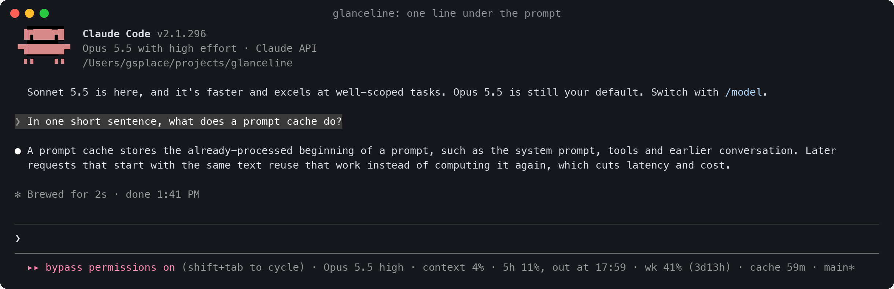
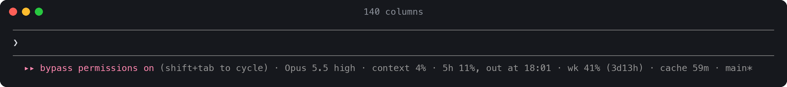
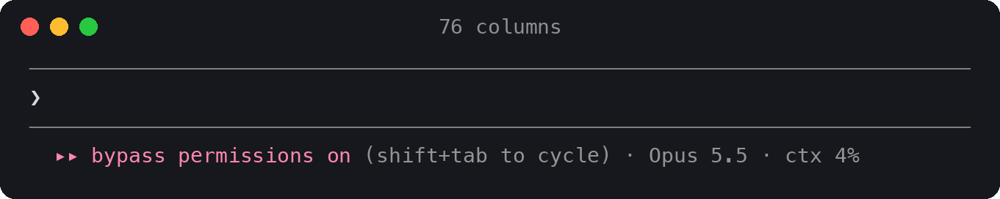

# glanceline

**Your Claude Code session at a glance, plus a heads-up before you hit a wall.**

glanceline is a native Claude Code **mod**: one live line under the prompt that shows your
context, your 5-hour and weekly limits (and when your current pace runs them out), how long
the prompt cache stays warm, and your git branch. It rides at the end of Claude Code's own
hint line, so it adds no rows to the screen. It also raises a toast *before* the cache goes
cold or a limit runs out, not after.



- **It takes no room.** No band, no extra status row: the figures sit on the line Claude
  Code already draws under the prompt, and the least important ones drop first when the
  terminal narrows.
- **It looks ahead.** `5h 88%, out at 14:24` means you'll hit the limit at 14:24 if you keep
  going at this pace. A status line only says 88%.
- **It's live.** Claude Code pushes usage to the mod as it changes, so there's nothing to
  poll and no process starts on every refresh.
- **It speaks up.** A toast arrives five minutes before a one-hour cache goes cold
  (one minute for a five-minute cache), and when a limit is on pace to run out early.
- **It's plain and honest.** Every figure comes from Claude Code itself. It doesn't parse
  transcripts or estimate tokens, makes no network calls and needs no dependencies.

## Install

In Claude Code 2.1.293 or later, type at the prompt:

```text
/plugin install glanceline --marketplace lifeofgurpreet/glanceline
```

Answer `y` to add the marketplace and pick a scope (user is the usual choice). The line
appears right away, with no restart. To remove it, run `/plugin uninstall glanceline`.

Older Claude Code? Use the [status line fallback](#works-everywhere-the-status-line-fallback).

## What you see

| Segment | Example | What it means |
| --- | --- | --- |
| model | `Opus 5.5 high` | The model, its reasoning effort, and `fast` when fast mode is on |
| context | `context 41% (118k left)` | How full the context window is, from the last response |
| 5h | `5h 23% (resets in 2h 14m, on track)` | Your 5-hour usage window |
| 5h, running hot | `5h 72%, out at 10:03` | At your average rate since the window opened, you hit 100% at 10:03, before the reset |
| week | `wk 41% (3d5h)` | Your weekly window, with the same pace check |
| spend | `spend $416 of $500 monthly` | Shown behind a Claude gateway that sets a spend limit |
| cache | `cache 59m` / `cache cold` | How long the prompt cache stays warm. When it's cold, the next turn rebuilds it |
| git | `feat/checkout*` | Your branch. `*` means tracked files have changes |
| cost, time | `$3.21 at API prices` · `1h 12m session` | In the `full` preset |

The line is drawn dim, like the rest of Claude Code's footer, and its words carry the
warnings (`out at 14:24`, `cache cold`); the toasts and the details pane add color:
green for healthy, yellow when you're close, red when you're at the edge.

### It fits any width

Every segment has a wide, a medium and a short form. The whole line narrows together,
and the least important segments drop first. The model, context and 5-hour window stay
until the very end.





### The details pane

`/glanceline` opens a pane with every figure spelled out: bars, reset times, what the
cache will cost to rebuild, and any warning that's live. `/glanceline off` hides the line,
and `/glanceline on` brings it back.


## Configure

`/config` lists three settings: **layout** (`default`, `minimal` or `full`), **icons**
(`none` or `nerd`, for Nerd Font glyphs) and **heads-up toasts** (on or off).

For more control, add `~/.config/glanceline/config.json` (or put it under
`$XDG_CONFIG_HOME`):

```json
{
  "preset": "full",
  "segments": "model,context,five_hour,cache|git,cost",
  "icons": "none",
  "toasts": true,
  "cache_ttl": "auto",
  "account_command": ["sh", "-c", "echo account $(git config user.email)"]
}
```

| Key | Values | Default |
| --- | --- | --- |
| `preset` | `minimal` (model, context, 5h, cache), `default` (adds week, spend, git), `full` (two lines, with bars, cost and time) | `default` |
| `segments` | Your own layout. Keys: `model`, `context`, `five_hour`, `seven_day`, `spend`, `cache`, `git`, `pr`, `cost`, `time`, `lines`, `vim`. Separate them with `,` and start a new line with `\|` | the preset's |
| `icons` | `none`, `nerd` | `none` |
| `toasts` | `true`, `false` | `true` |
| `cache_ttl` | `auto`, `5m`, `1h` (see the FAQ) | `auto` |
| `account_command` | A command, as an argv list, whose first output line is added at the end of the line (`account you@example.com (via CAAM)` shows as `you@example.com`). It runs at start and every ten minutes. Use it for which account or cluster you're on. Off unless you set it, so screenshots don't show who you are | none |

A `config.json` placed next to the plugin's `plugin.json` sets defaults for everyone who
uses that copy, which is handy for a team.

## Works everywhere: the status line fallback

The mod needs Claude Code 2.1.293 or later. On any version, `glanceline.py` runs as a
classic `statusLine` command and prints the same segments with the same wording. It's a
single standard-library Python file and works with Python 3.8 or later on macOS and Linux.

```sh
curl -fsSL https://raw.githubusercontent.com/lifeofgurpreet/glanceline/main/install.sh | sh
```

The installer copies the script to `~/.local/bin/glanceline` and changes one key in
`~/.claude/settings.json`: `statusLine`. It saves a backup first and records the status
line it replaced. To undo it, run:

```sh
glanceline uninstall     # puts your previous statusLine back, byte for byte when nothing else changed
```

- `glanceline demo` prints sample lines at four widths.
- Settings come from the same `config.json` (`preset`, `segments`, `icons`, plus
  `theme`: `color` or `mono`), or from `GLANCELINE_PRESET`, `GLANCELINE_SEGMENTS`,
  `GLANCELINE_ICONS` and `GLANCELINE_THEME`. `NO_COLOR` is respected.
- `--extra-command CMD` adds that command's output below the line.
- When the mod is also installed, the fallback steps aside in that session, so you never
  see the same figures twice: the mod keeps `~/.cache/glanceline/live/<session id>` fresh,
  and the fallback prints nothing while that file is under a minute old. Claude Code still
  keeps an empty row for a configured status line, so once the mod runs everywhere you
  use, `glanceline uninstall` gives that row back.

The two share one core: `hooks/core.ts` for the mod and its line-for-line port in
`glanceline.py`. Both are tested against the same golden file, `tests/cases.ts`.

## FAQ

**What does "cache warm 59m" mean?**
Claude Code keeps your conversation in Anthropic's prompt cache, so each turn re-reads it
cheaply instead of processing it again. The cache lasts a set time after your last
message: one hour on a Claude subscription within its limits, five minutes on an API key
or a cloud provider. After that it goes **cold**, and your next message rebuilds all of it
(`cache cold (next turn rebuilds 84k)`), which is slower and uses more of your limit.
glanceline counts down and warns you shortly before that happens.

**How does it know 1 hour vs 5 minutes?**
It applies Claude Code's own rule: `FORCE_PROMPT_CACHING_5M`, `CLAUDE_CODE_PROMPT_CACHE_TTL`,
the `promptCacheTtl` setting, `ENABLE_PROMPT_CACHING_1H`, and otherwise one hour on a
subscription and five minutes elsewhere. If it later sees the cache hit or miss after a
long pause, it corrects itself. You can also pin it with `cache_ttl`. (The fallback reads
the exact expiry, because the status line gets it from Claude Code directly.)

**What does "on track" / "out at 14:24" mean?**
glanceline takes your usage so far in the window, divides it by the time since the window
opened, and projects that rate forward. If the projection reaches 100% before the reset,
you see the time. It stays quiet for the first 15 minutes of a 5-hour window and the first
12 hours of a week, while the average still means little.

**Is the dollar figure my bill?**
No. It's Claude Code's estimate of the session at API list prices. On a subscription it's
a sense of scale, not a charge.

**Does it read my conversation or send anything anywhere?**
No. It reads the figures Claude Code hands every mod and runs `git status` in your project.
Nothing leaves your machine.

**Something's missing.**
Usage windows show up after the first response of a session, and only on a subscription.
The cache segment appears once a response reports cache tokens. Lines added and removed
come from the status line payload, so only the fallback shows them.

## How is this different from other status lines?

Projects like ccstatusline, claude-powerline and claude-hud are `statusLine` commands. Claude
Code starts them as a new process on every refresh, and several of them parse the session
transcript to work out tokens and costs. glanceline is a mod: it runs inside Claude Code,
receives usage as it changes, writes onto the line Claude Code already draws under the prompt
instead of adding one, and can do what a status line can't, such as raising a toast, opening
a pane or adding a command. It's also deliberately small: about 750 lines of
TypeScript with no dependencies.

## Develop

```sh
claude plugin validate .               # what the engine sees and would refuse
claude plugin test .                   # mod tests, including the golden file
python3 tests/test_glanceline.py       # fallback tests: golden parity, install round trips, garbage input
bun scripts/golden.ts                  # regenerate tests/cases.ts after changing hooks/core.ts
claude --plugin-dir .                  # run a session with your working copy
```

The screenshots are real captures (`tmux capture-pane -e`), rendered by `scripts/ansi2svg.py`
and `scripts/ansi2png.py`.

## License

MIT
