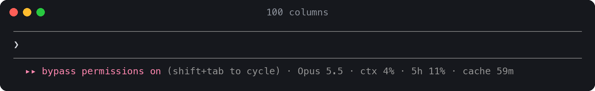
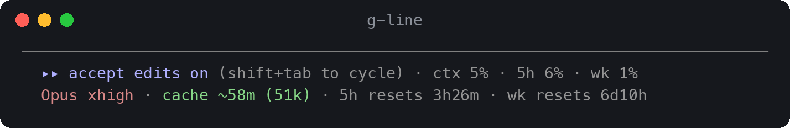
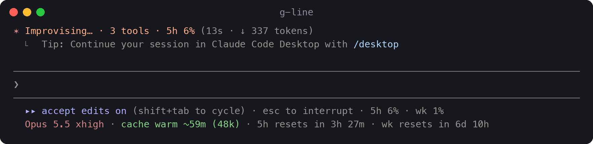
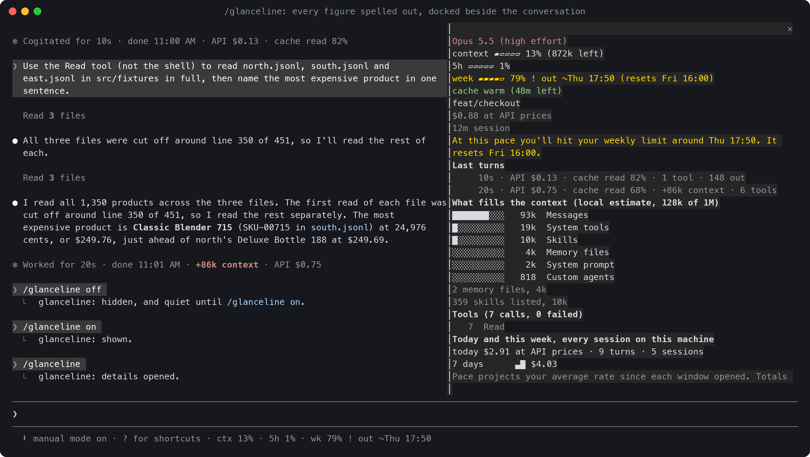
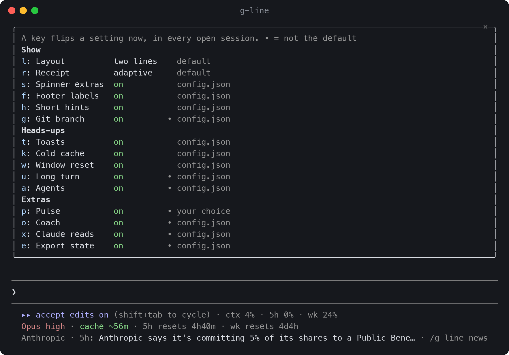

# g-line

**Live status. Receipts on the turns.**

g-line is a Claude Code mod. It writes context jumps, cache rebuilds and tool failures on the
turns where they happened, and keeps the model, its effort, the prompt cache and your usage
windows in two short lines under the prompt.

In Claude Code 2.1.293 or later, type at the prompt:

```text
/plugin install g-line --marketplace lifeofgurpreet/g-line
```

Answer `y` to add the marketplace and pick a scope (user is the usual choice). The mod starts
at once, with no restart. `/plugin uninstall g-line` removes it.


## What you get

- **A receipt on every turn.** The line that closes a turn (`Worked for 20s · done 11:01 AM`)
  gains what the turn cost at API prices and how much of its input the prompt cache served:
  `API $0.22 · cache read 49%`. A turn that did something unusual leads with it, in colour:
  `+86k context`, `cache cold · rebuilt 42k`, `3 failed Bash calls`, `compacted 182k → 31k`,
  `API $1.42 · 4x recent`. Scroll back and you can see which turn changed things.
- **The running turn on the spinner.** `3 tools · +4.1k ctx · 5h 74%` while it works, and
  `⚠ 3× Edit failures on core.ts` when calls keep failing.
- **Two lines under the prompt.** Context and usage at the end of Claude Code's own hint line
  (`ctx 13% · 5h 1% · wk 79%!`), and one coloured row with the model, the cache countdown and
  what happens next (`Opus 5.5 high · cache ~59m · wk full in ~1d 4h, back Fri 16:00`).
  Nothing goes above the prompt.
- **Heads-ups.** A native notification five minutes before a one-hour prompt cache goes cold,
  with the context at stake (`Claude cache goes cold in 5m (148k of context at risk)`), and
  another when a usage window you came close to resets.
- **The cache after a restart.** A resumed conversation (`--resume`, `--continue`, a terminal
  restored after a reboot) shows its cache before its first turn: `cache warm ~41m (180k)` or
  `cache cold, next turn rebuilds 486k`.
- **A dashboard.** `/g-line dashboard` opens a local page with your usage windows, the sessions
  on this machine, and two weeks of turns, cost and cache rebuilds.

Optional, and off until you turn them on: [guard rules](docs/guard.md) for a low usage window,
[keep-warm](docs/guard.md#keep-warm) for idle prompt caches, and [Pulse](docs/pulse.md)
headlines.


## What you see

### The receipt

| Receipt | When |
| --- | --- |
| `API $0.22 · cache read 49%` | An ordinary turn: its cost at API prices and the share of its input the cache served |
| `+86k context` | The turn grew the context by at least 8k tokens, or by 2% of the window when that is more |
| `cache cold · rebuilt 42k` | The turn's first request came after the cache's lifetime and rewrote it |
| `cache write 84k` | A request wrote at least 20k tokens to the cache, well beyond what the context grew |
| `3 failed Bash calls` | Two or more tool calls failed in the turn (named when they were all one tool) |
| `compacted 182k → 31k` | The context was compacted during the turn |
| `API $1.42 · 4x recent` | At least three times the median of your recent turns, and at least 20 cents more |
| `answered by Sonnet 5.5` | A model other than the one asked for answered (Claude Code fell back) |

A receipt records what happened. It says a cold cache was rebuilt and leaves the cause to you.
When a background agent ran alongside the turn, the session's cost growth isn't the
turn's alone, so the dollar figure is left out. A narrow terminal drops the supporting facts
first.

### The two lines under the prompt

Line 1 is the end of Claude Code's hint line, drawn dim:

| Segment | Example | Meaning |
| --- | --- | --- |
| context | `ctx 13%` | How full the context window is, from the last response |
| 5h, week | `5h 1%`, `wk 79%!` | Your usage windows. `!` means on pace to run out before the reset |
| spend | `spend 83%` | Behind a Claude gateway that sets a spend limit |

Line 2 is g-line's own row, in colour:

| Segment | Example | Meaning |
| --- | --- | --- |
| model | `Opus 5.5 high` | The model and the effort of the last request (`fast` when fast mode is on) |
| cache | `cache ~59m`, `cache cold` | How long the prompt cache stays warm: green, then amber in its last minutes. `~` because it's an estimate from when the last request ran and the cache's lifetime. After a compaction it shows the summary the next turn will write instead |
| timing | `wk full in ~1d 4h, back Fri 16:00` | How long until a window on pace to run out fills (a projection, so rounded) and when it comes back; otherwise when it resets |
| agents, compaction | `agents 2 running`, `compacts in ~3 turns` | While subagents work; when a compaction is near |
| others | `2 others · 1 waiting` | Other g-line sessions on this machine, and how many are waiting on you for a permission answer. `roster: false` turns it off |
| guard | `guard: effort medium`, `kept warm 2× · $0.08` | Only with your [guard](docs/guard.md) rules: what they're doing now |

When the terminal narrows, line 2 shortens first (`Opus 5.5` to `Opus`, the effort kept), and
what line 1 can't fit moves down rather than disappearing. A healthy window's reset time goes
first; a warning keeps its projection the longest.




Prefer one line? Set `lines` to `1`: everything goes on the hint line, and Claude Code's
standing hint `(shift+tab to cycle)` shortens to `⇧⇥` to make room. Already using another
status line? Set `lines` to `receipts`: g-line then adds only the receipts, the spinner and the
heads-ups.

### The spinner

`Sautéing… · 3 tools · +4.1k ctx · 5h 74%` while a turn runs, and
`⚠ 3× Edit failures on core.ts` first once calls keep failing.



### The pane, settings and dashboard

`/g-line` opens a pane with every figure spelled out: limits with bars and reset times on your
own clock (`5-hour 62% used, resets 14:12 (in 2h 47m)`), warnings, agents, the last turns'
receipts, what fills the context, tools used and failed, the other sessions on this machine, and
today's and this week's totals. Its top row flips common settings with one key (`l` layout,
`r` receipt, `p` Pulse); `s` opens all settings, `n` the news reader and `b` the dashboard.



`/g-line settings` lists every setting with its value and where the value comes from
(`default`, `config.json`, `/config` or `your choice`). Press a key and the setting changes at
once, in every open session.



`/g-line dashboard` writes a local page and opens it in your browser: usage windows, this
machine's sessions, and two weeks of history. It loads nothing from the network. See
[the dashboard](docs/dashboard.md).

`/g-line card` shows a share card of the session, without your repository, branch, paths or
account. `/g-line off` hides everything g-line draws until `/g-line on`.

## Optional features

- **[Guard](docs/guard.md).** Rules you write for a low usage window: lower the effort, start new
  subagents on a cheaper model, or hold new prompts, by window, account, group and office hours,
  or by pace through the week. With no rules, g-line changes nothing. Everything it does is
  shown on line 2, in a toast and on the turn's closing line, and `/g-line guard simulate` tries
  your rules without spending anything.
- **[Keep-warm](docs/guard.md#keep-warm).** Re-reads an idle conversation's prompt cache before
  its hour runs out, so the next prompt doesn't pay to rebuild it. Each re-read is shown with its
  cost.
- **[Pulse](docs/pulse.md).** AI news headlines on a dim row under the prompt, from one static
  file fetched at most every 45 minutes, with a reader at `/g-line news`.

## Configure

`/g-line settings` changes every on/off and layout choice. To set them for every session or
machine, write `~/.config/g-line/config.json`; running sessions pick up an edit within 15
seconds. If you switch accounts with a tool of your own, `account_command` lets g-line see the
switch and share usage readings between sessions. All settings are in
[Configuration](docs/configuration.md).

```json
{
  "lines": 2,
  "git": true,
  "notify": { "cache": true, "reset": true, "long_turn": true },
  "today_budget": 50
}
```

## Why a mod

A `statusLine` command is a separate program: Claude Code runs it and prints its output in a
status area under the prompt. A mod runs inside Claude Code and can draw on Claude Code's own
lines. That is what lets g-line:

- write a receipt on each turn's own closing line, where it stays in scrollback beside the turn;
- show the burn and failures on the spinner while the turn runs;
- put the gauges at the end of the existing hint line, so the footer grows by one row;
- read each request's cache reads and writes, every tool call and its result, subagents and
  compactions from the engine as they happen, rather than from the transcript file;
- offer a `/g-line` command that runs without a Claude turn, a pane with buttons, and native
  notifications.

## How it compares

From each project's README on 2026-10-14. "Not documented" means not in its docs, not that it
can't be done.

| | g-line | claude-hud | ccstatusline | claude-powerline | ccusage |
| --- | --- | --- | --- | --- | --- |
| What it is | Claude Code mod | Plugin that sets up a `statusLine` command | `statusLine` command | `statusLine` command | Usage-report CLI with a statusline command |
| Where it draws | The hint line, one row under it, the spinner, each turn's closing line | Its status lines (two by default) | Its status lines, configurable | Its status lines, powerline style | Its status line, and separate reports |
| Receipt on each turn's own line | Yes | Not documented | Not documented | Not documented | Not documented |
| Model and effort | Yes | Yes (effort optional) | Yes (widget) | Yes | When Claude Code supplies it |
| Prompt-cache countdown | Yes, an estimate | Optional | Yes (widget) | Optional | Not documented |
| Limits with pace | Projected run-out time | Usage windows, pace colours | Usage and reset widgets | Usage with an even-spend pace marker | Block cost, time and burn rate |
| History | Receipts in scrollback; today, this week and a 14-day dashboard | Optional cost ledger | Session and compaction widgets | Today and month budgets | Daily, monthly and session reports |
| Where activity comes from | Engine events | Status data; optional lines read the transcript | Status data, transcript and usage API, by widget | Status data and local transcripts, by feature | Local usage records |
| Pick it to | See which turn changed things, beside the work | Get a configurable session overview | Get extensive widget customisation | Get a styled layout with budgets | Get retrospective usage analysis |

## Privacy and what it runs

- **Reads:** the figures Claude Code hands every mod (usage, turns, tool calls and whether they
  succeeded, subagents, compactions). It doesn't read the transcript file.
- **Keeps:** per session per day, numbers only (cost at API prices, turns, tool calls, cold
  rebuilds, keep-warm re-reads, agents) in Claude Code's plugin store, deleted after 35 days;
  your choices made with `/g-line`; when you last opened the news reader; with Pulse on, the
  last feed and which headlines it showed today; and, with `roster` on (the default), each
  running session's heartbeat (state, context, cache, model, and the `account_command` line only
  if you set one), cleared when the session ends.
- **Runs:** `git status` only with `git: true` or while the pane is open; your `account_command`
  and `usage_command` only if you set them; `uname -s` once per session, to know whether a
  browser can open; `open` (or `xdg-open`) when you ask to open a link or the dashboard.
- **Sends:** nothing, unless Pulse is on (one GET of a static file) or you turn on
  `claude_reads` (the snapshot goes into your conversation). With keep-warm in your `guard`,
  Claude Code sends your conversation again, through its own client, to re-read the cache.
- **Changes:** nothing, unless you write `guard` rules: then a lower effort, a cheaper model for
  new subagents, a held prompt, or with `resume` one prompt after a limit's reset, each as your
  rule says and each shown.
- **Writes:** a one-line timestamp at `~/.cache/glanceline/live/<session id>` so an older status
  line command can step aside; with `export_state`, a JSON file for other bars; and
  `~/.cache/g-line/dashboard.html` when you ask for the dashboard.

Claude Code already notifies you when it waits for a permission answer or for your input, so
g-line adds no "Claude is waiting" notifications of its own.

## Upgrading from glanceline

glanceline is now g-line, at `lifeofgurpreet/g-line` (the old address redirects). Claude Code
treats the new name as a new plugin, so an installed glanceline updates to a small stub that
tells you, once per session, to switch:

```text
/plugin uninstall glanceline
/plugin install g-line --marketplace lifeofgurpreet/g-line
```

Your `~/.config/glanceline/config.json` keeps working. If you used the old Python status line
(`glanceline install`), run `glanceline uninstall` once to put your previous `statusLine` back.

## Contributing

Issues and pull requests are welcome; see [CONTRIBUTING.md](CONTRIBUTING.md). [AGENTS.md](AGENTS.md)
has the rules g-line stands on, a map of the code, and recipes for adding a figure or a receipt
event.

```sh
claude --plugin-dir .        # a session with your working copy; saving reloads it
claude plugin validate .     # what the engine reads, the hooks and calls, what it would refuse
claude plugin test .         # the tests
```

The terminal screenshots are real captures (`tmux capture-pane -e`), drawn by
`scripts/ansi2png.py`. The dashboard image is the real page generator run on sample data.

## License

[MIT](LICENSE)
